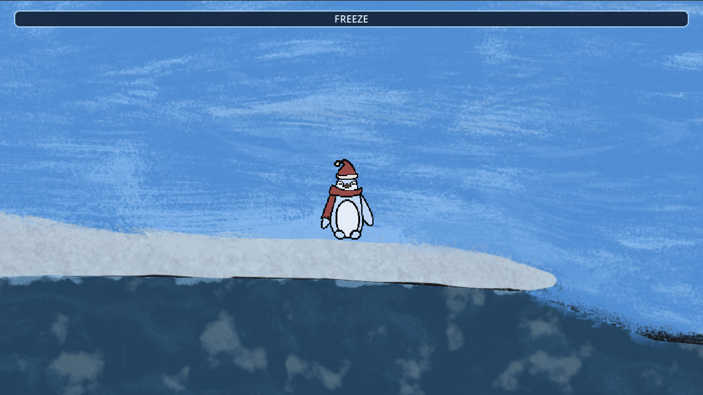
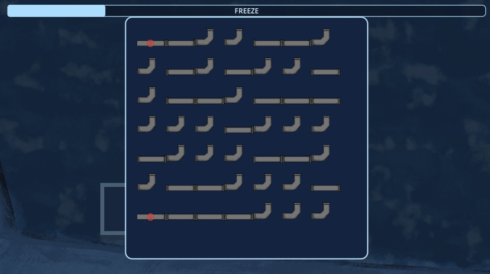

# Glowbeon's Station

In this 2D game, a penguin explores underwater caves and solves puzzles to activate a machine that reverses global warning to stop the water from rising. The penguin was raised by researchers, who had to leave after fundings were cut, abandoning their research station.

**Play** on [itch](itch.io) or

1. Download or clone the repository
2. Open Godot
3. Click on import
4. Select the folder
5. Play, edit and enjoy!

This project was created by Apolo (@no-apologizes), Hannah (@Hannah3142) and Maya (@mayaacodes) for Hackclub's athena event Snowglobe in November 2026 using Godot 4.7.2

We build this project ourselved using godot to programm and Procreate and Pixilart for the art. In the end, AI helped combine the two minigames with the world, so everything could be played at the deadline.